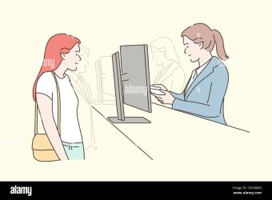

 Jad, the student waiting

> "Wish I could save less time waiting in offices"

| | |
| --- | --- |
| **Photo or sketch** |  |
| Age, role and background | 21, 2nd year Nursing student, commutes, has back-to-back classes |
| **Goals** | Request official documents efficiently and process enrollment-related requirements faster |
| **Frustrations** | Unpredictable 20–40 minute wait times without transparency. Time could've been spent on something productive |
| **Devices and context** | No device involved, just waiting in line without knowing how soon her turn would come |
| **Tech comfort** | High; routine smartphone user who expects real-time digital updates to manage a hectic academic schedule |
| **Accessibility needs** | Quick-glance UI (needs to read data instantly while walking), reliable performance on low mobile data or weak campus Wi-Fi |

### Scenario

Jad arrives at the registrar during a tight gap between back-to-back nursing classes to submit enrollment requirements. Seeing a crowd of students already waiting, Jad opens the queuing app to have a clear picture of the delay. Instead of guessing based on crowd size, Jad uses the app to check the live queue number, exact position in line, and estimated waiting time. Seeing a 30-minute estimated wait, Jad comfortably leaves the crowded room to review lecture notes nearby, returning to the window exactly when a push notification signals that their turn is approaching.

### Top tasks in the app

| Task | Screen | Requirement ID |
| --- | --- | --- |
| Check current registrar office service availability status | Home / Dashboard | FR-01 |
| Join the digital line for document requests / enrollment | Join Queue | FR-01 |
| Check the live queue number, position, and students ahead | Dashboard / Home | FR-02 |
| View the estimated waiting time countdown| Queue Tracker | FR-02 |
| Receive a notification update when their turn is approaching | Alerts | FR-06 |

### What this means for my interface

1. Because Jad needs to safely leave the physical line to study or walk, my interface must feature a real-time countdown clock and live placement counter so they aren't forced to stay pinned to the office.
2. Because Jad needs to check her status on the go, my interface must use a clean, high-contrast dashboard layout that highlights her  queue status instantly and is fully accessible on mobile browsers.
3. Because Jad needs to see her standing instantly from a distance, my interface must feature a massive, color-coded status banner (Green for "Short Wait", Yellow for "Approaching", Red for "Your Turn") that dominates the screen.

### Ms. Elena, the Registrar Staff Member

> "I need to assist each person in order while making sure the transactions are handled properly."

| | |
| --- | --- |
| **Photo or sketch** | |
| **Age, role and background** | 38, university registrar staff member who assists students with enrollment-related concerns, academic record inquiries, and document requests. Works at a service counter and handles requests throughout the day. |
| **Goals** | Assist students with their registrar concerns; serve people in the correct order; complete transactions efficiently without unnecessary delays. |
| **Frustrations** | Students may need to wait at the office without knowing how long the line will take; managing additional virtual requests could become inconvenient if the system adds extra steps |
| **Devices and context** | Uses an office desktop computer for administrative work while assisting students who are lined up at the counter |
| **Tech comfort** | Medium; can use common computer applications but prefers a system with a straightforward layout and clearly labeled actions. |
| **Accessibility needs** | Readable text, clear status labels, visible action buttons, and a simple layout that can be used quickly while attending to students. |

### Scenario

Ms. Elena starts her workday at the registrar counter, where students form a physical line and wait for assistance. She serves them in order while handling enrollment concerns and document requests. Some students may spend time waiting without knowing when their turn will come. If the Virtual Registrar Queue System is available, students can join the virtual queue and monitor their progress before approaching the office. Ms. Elena opens the staff dashboard to view virtual queue requests, calls the next student when appropriate, and updates the student's status after the transaction. The system should fit into her existing workflow without interfering with students who are already waiting in person.

### Top tasks in the app

| Task | Screen | Requirement ID |
| --- | --- | --- |
| View students who have joined the virtual queue | Staff Dashboard | FR-03 |
| Call the next student when ready to serve them | Staff Dashboard | FR-03 |
| Update a student's status to served or no-show | Staff Dashboard | FR-05|

### What this means for my interface

1. Because the registrar already manages the physical line successfully, my interface must support the existing workflow rather than add unnecessary steps in managing the queue.  
2.  Because staff members must continue handling their regular registrar responsibilities, my interface must make calling students and updating queue statuses quick and straightforward.  
3.  Because the staff member must serve people in the correct order, my interface must clearly display queue positions and provide a straightforward way to call the next person.  
